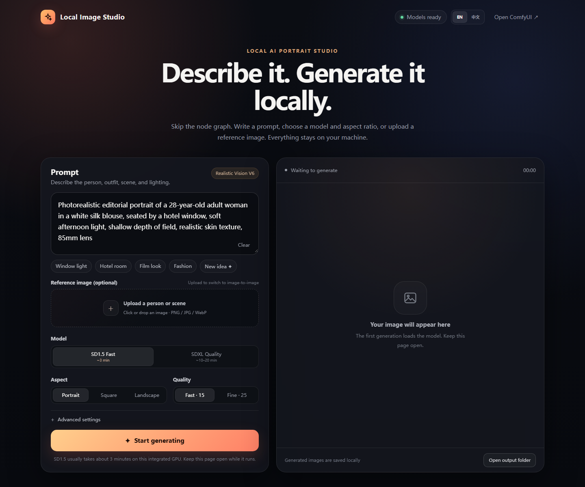
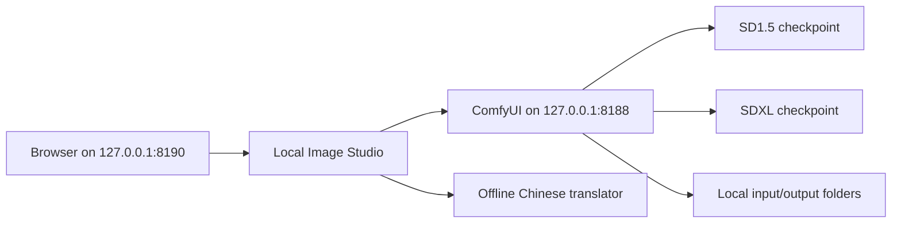

# Local Image Studio

A local-first, one-click web interface for ComfyUI with text-to-image and
image-to-image workflows.



Local Image Studio removes the usual node-graph friction without moving
inference to a hosted service. It runs on `127.0.0.1`, talks to a local ComfyUI
instance, and keeps prompts and generated images on your machine.

## Why this project

- **No hosted moderation layer.** The wrapper does not inspect, block, or send
  prompts to a cloud moderation API.
- **No account and no telemetry.** The app adds no analytics or remote inference.
- **One-click workflow.** A focused browser UI replaces manual node editing for
  everyday generation.
- **SD1.5 and SDXL profiles.** The UI handles checkpoints, dimensions, sampler
  settings, and queue status.
- **Text and reference-image generation.** Standard img2img includes three
  denoising presets for subtle edits or larger reinterpretations.
- **Chinese prompt support.** Chinese is translated offline before CLIP
  encoding; English prompts work directly.
- **Bilingual interface.** Switch between English and Simplified Chinese from
  the top-right control. The choice is remembered in the browser.
- **Small hardware support.** The included DirectML patch and `--lowvram`
  workflow were tested on an AMD Radeon 780M integrated GPU.

> **What “unfiltered” means here:** this software does not add a content
> moderation service or call an external API. It is not a promise that a model
> can generate every request, and it does not override local law, platform
> rules, or model licenses. You are responsible for how you use it.

## Demo output

This image was generated locally through the same API path used by the UI:


## Architecture



## Features

### Text to image

Enter a prompt, choose SD1.5 or SDXL, select an aspect ratio and quality preset,
then generate. The app creates the ComfyUI graph and polls the local queue.

### Image to image

Drop in a PNG, JPEG, or WebP reference. The app center-crops and resizes it to
the selected output dimensions, then runs a standard VAE-encoded img2img pass.

| Strength | Behavior |
|----------|----------|
| `0.40` | Preserve more of the original identity, pose, and composition |
| `0.55` | Balanced outfit, setting, and scene changes |
| `0.70` | Larger creative changes with less likeness retention |

Standard img2img is not a dedicated face-identity model. For stronger identity
reuse, consider adding an IP-Adapter or FaceID workflow and a matching model.

### Local gallery

Generated images can be previewed, downloaded, or opened from the local output
directory. `?clean=1` hides the recent-gallery section, which is useful for
screenshots and presentations.

## Tested environment

| Component | Tested version |
|-----------|----------------|
| OS | Windows 11 |
| GPU | AMD Radeon 780M |
| ComfyUI | 0.7.0 |
| Python | 3.12.13 |
| PyTorch | 2.4.1 |
| torch-directml | 0.2.5.dev240914 |

Linux and macOS may work with small path/startup changes, but are not covered by
the current test matrix.

## Requirements

- ComfyUI and its Python virtual environment
- Pillow
- Transformers for the optional offline translation node
- One SD1.5 checkpoint and/or one SDXL checkpoint

The default profiles expect these filenames:

```text
realisticVisionV60B1_v51VAE.safetensors
CyberRealisticXLPlay_V9.0_FP16.safetensors
```

The checkpoints are not included because of size and third-party licenses.
Change `MODEL_PROFILES` in `server.py` to use different filenames.

## Quick start

### 1. Clone

```powershell
git clone https://github.com/ZhuangHT-1201/local-image-studio.git
cd local-image-studio
```

### 2. Install the small Python dependency set

```powershell
& "C:\ComfyUI\venv\Scripts\python.exe" -m pip install -r requirements.txt
```

### 3. Configure

```powershell
Copy-Item .\config.example.json .\config.json
```

Edit `config.json` so `comfyui_dir` and `start_script` point to your ComfyUI
installation. `config.json` is ignored by Git.

`scripts/start-comfyui-directml.example.bat` is a starting point for a custom
DirectML launcher. Copy it, update `COMFY_DIR`, and point `start_script` to it.

### 4. Add the offline Chinese prompt node

```powershell
Copy-Item .\custom_nodes\zh_prompt_translate `
  "C:\ComfyUI\custom_nodes\" -Recurse
```

Place the `Helsinki-NLP/opus-mt-zh-en` model files at:

```text
C:\ComfyUI\models\translation\opus-mt-zh-en\
```

English prompts work without the translation model.

### 5. Optional: install the example workflows

```powershell
Copy-Item .\workflows\*.json `
  "C:\ComfyUI\user\default\workflows\" -Force
```

### 6. Optional: apply the DirectML compatibility patch

The patch was written against ComfyUI `v0.7.0`. Check that it applies before
changing your installation:

```powershell
git -C "C:\ComfyUI" apply --check `
  ".\patches\directml-compat.patch"
git -C "C:\ComfyUI" apply `
  ".\patches\directml-compat.patch"
```

The patch:

- moves split-attention math to CPU when using `torch-directml`;
- runs VAE decode on CPU for DirectML compatibility.

For larger checkpoints such as SDXL, start ComfyUI with `--lowvram` as well:

```text
main.py --directml --lowvram --use-split-cross-attention
```

Keep the startup flags required by your own ComfyUI setup.

### 7. Start

```powershell
& "C:\ComfyUI\venv\Scripts\pythonw.exe" .\launcher.py
```

The launcher starts the local UI, waits for it, and opens:

```text
http://127.0.0.1:8190
```

Add `?lang=en` or `?lang=zh` to force a language for a session. Without an
override, the app follows the browser language on first launch.

To create a desktop shortcut on Windows, set:

- Target: `C:\ComfyUI\venv\Scripts\pythonw.exe`
- Arguments: `"<path-to-repo>\launcher.py"`
- Start in: `<path-to-repo>`

## Configuration

```json
{
  "comfyui_dir": "C:\\ComfyUI",
  "comfyui_url": "http://127.0.0.1:8188",
  "start_script": "C:\\ComfyUI\\start-comfyui.bat",
  "icon_path": "C:\\ComfyUI\\ComfyUI.ico"
}
```

Environment variables `COMFYUI_DIR`, `COMFYUI_URL`, `COMFYUI_START_SCRIPT`, and
`COMFYUI_ICON` are also supported.

## Privacy

- The web server binds to `127.0.0.1` only.
- Uploaded references are written to ComfyUI's local `input` directory.
- Outputs are written to ComfyUI's local `output` directory.
- Local Image Studio has no account system, telemetry, or hosted inference.
- ComfyUI Manager may perform its own network checks when enabled.

This repository intentionally contains no NSFW media or private reference
photos.

## Notes and limitations

- DirectML remains slower than CUDA and is sensitive to ComfyUI/PyTorch versions.
- SDXL is substantially slower with `--lowvram` on integrated GPUs.
- The UI supports English and Simplified Chinese; prompts accept both languages.
- The reference-image feature is standard img2img, not exact identity cloning.

## Validation performed

- SD1.5 text-to-image: 512 × 768, 5 steps, successful local output.
- SDXL text-to-image: 832 × 1216, 5 steps, successful local output.
- SDXL image-to-image: 832 × 1216, 5 steps, successful local output.
- One-click launcher: verified with both the UI and ComfyUI stopped beforehand.

Generation time depends heavily on the GPU, driver, model, resolution, and
sampling settings.

## License

The application code is available under the MIT License. ComfyUI, checkpoints,
translation models, and other third-party components retain their own licenses.

